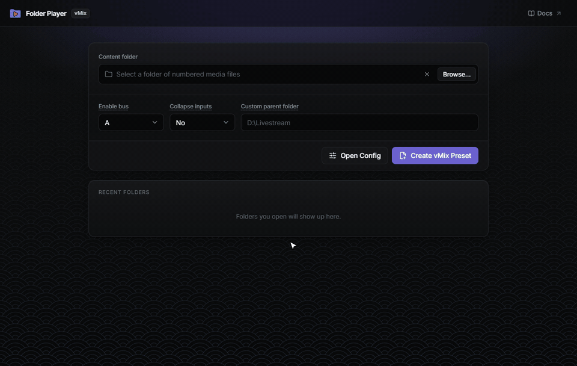
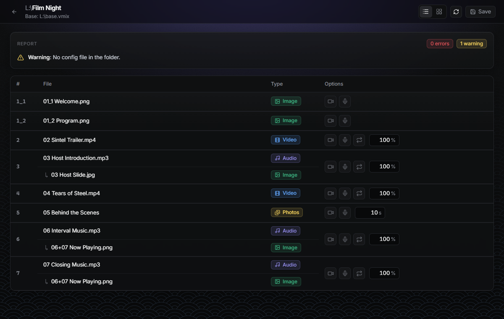
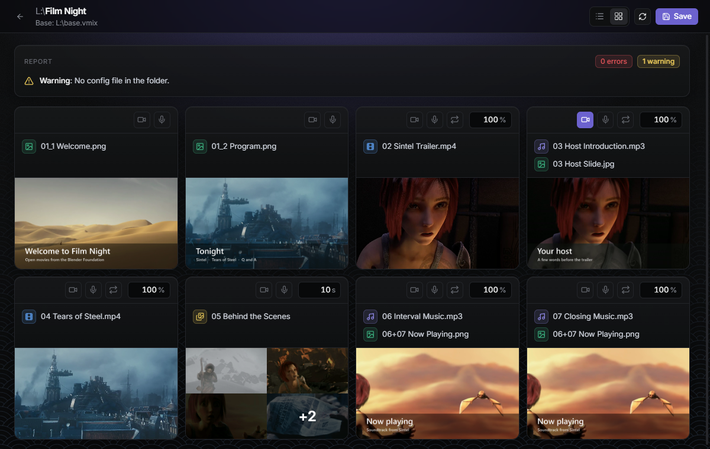
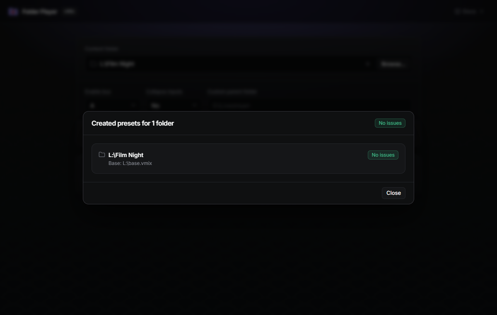

# vMix Folder Player

_Number your files. Get a ready-to-run vMix playlist._

[](https://github.com/live-miracles/folder-player/actions/workflows/ci.yml)
[](https://github.com/live-miracles/folder-player/releases/latest)
[](LICENSE)
[](https://live-miracles.github.io/projects/folder-player/)

**A free, open-source Windows app that turns a folder of numbered media files into a vMix preset (`.vmix`).** Drop your videos, audio, images, photo folders and PowerPoint decks into one folder, number them in playing order, and the app builds the playlist for you, with overlays, camera and microphone layers already in place.

| [Download](#download) | [Documentation](https://live-miracles.github.io/projects/folder-player/docs/) | [Report a bug](https://github.com/live-miracles/folder-player/issues/new) |
| --------------------- | ----------------------------------------------------------------------------- | ------------------------------------------------------------------------- |

[](assets/folder-player-config-preview.png)

_Pick a folder, review the playlist, turn on the camera and mic for the host's lower third, save, and create the preset. Demo media: Blender Foundation open movies ([credits](assets/CREDITS.md)). Select the demo for a full-size still._

**Saves you setup time before every session? [Download Folder Player](https://github.com/live-miracles/folder-player/releases/latest) and [give it a star](https://github.com/live-miracles/folder-player) to help other vMix operators find it.**

**Who it's for:** vMix operators, live stream and AV teams, and anyone who rebuilds a similar playlist for every event: a welcome slide, a video, a talk with a background image, a photo slideshow, closing music. **Who it isn't for:** controlling vMix live (it writes a preset you open in vMix; it doesn't run alongside it) or playout on other software.

## Features

- **The folder is the playlist.** File names set the order: `01`, `02`, `03`… Anything without a number, like `Notes.txt`, is ignored.
- **Overlays by naming.** Give an image the same number as an audio or video file and it becomes that item's overlay. `06+07 Now Playing.png` reuses one overlay on items 6 and 7.
- **Every common input type.** Images, video, audio, folders of photos (played as a slideshow) and PowerPoint `.pptx` decks.
- **Camera and mic layers.** Turn the `Cam` and `Mic` inputs from your base preset on or off for each item, set its volume and loop, and set the slide time for slideshows.
- **Your base preset, extended.** Your cameras, mics and outputs stay as you set them up in `base.vmix`; the playlist is added on top.
- **Problems before you go live.** A report flags issues such as an audio file with nothing to show, a video covered by an overlay, or a camera option with no `Cam` input in the base preset.
- **Many sessions at once.** Point it at a parent folder and it creates a preset for every subfolder that has a config.

## How it works

### 1. Number your files

```text
Film Night
  |-- 01_1 Welcome.png          <- 01_1 and 01_2 play in order as item 1
  |-- 01_2 Program.png
  |-- 02 Sintel Trailer.mp4
  |-- 03 Host Lower Third.png   <- transparent PNG: turn on Cam and Mic to put the host on camera
  |-- 04 Tears of Steel.mp4
  |-- 05 Behind the Scenes      <- folder of photos: slideshow
  |-- 06 Interval Music.mp3
  |-- 07 Closing Music.mp3
  |-- 06+07 Now Playing.png     <- overlay on the audio, reused on items 6 and 7
  |-- Notes.txt                 <- no number: ignored
```

Put a `base.vmix` (your cameras, mics and outputs) in the folder or its parent. Title the camera input `Cam` and the microphone input `Mic` to layer them over items. See [Base vMix preset](docs/1-getting-started/2-base-preset.md).

### 2. Review the playlist

Open the folder in the app and click **Open Config**. Check the order and the report, and set each item's options: camera, mic, loop, volume, or slideshow time.



Switch to the preview view to see each item's media at a glance:



### 3. Create the vMix preset

Save, go back and click **Create vMix Preset**. The app writes `<folder name>.vmix` into the content folder and shows a report. Open that file in vMix and you're ready to play.



The full guides are in the [documentation](docs/README.md), also reachable from the **Docs** button in the app.

## Download

You don't need Node.js or the source code to use it.

1. Open the [Releases page](https://github.com/live-miracles/folder-player/releases/latest).
2. Under **Assets**, download `vMix-Folder-Player-Setup-x.x.x.exe` (Windows 10/11, 64-bit). Ignore `latest.yml` and the `.blockmap` file; the app's automatic updater uses them.
3. Run the installer. When a new version is released, the app offers to download and install it.

The installer is not code-signed yet, so Windows SmartScreen may warn you the first time. Choose **More info → Run anyway**.

## Get help and give feedback

- **Bugs and ideas:** [open an issue](https://github.com/live-miracles/folder-player/issues/new) with the app version, what's in your folder and what you expected.
- **More projects from the team:** [live-miracles.github.io](https://live-miracles.github.io/) lists the rest of the open-source streaming tools we use, such as [Live Gallery](https://github.com/live-miracles/live-gallery), a multiviewer for live streams.

## Development

```sh
npm ci
npm run css   # Tailwind watcher, in one terminal
npm run dev   # TypeScript watchers and Electron with reload, in another
```

Useful scripts:

```sh
npm run build         # Compile CSS, backend, preload and UI
npm test              # Build, then run the Node test suite
npm run format        # Format with Prettier
npm run format:check  # Check formatting without changing files
npm run dist          # Build a local Windows installer into release/
```

GitHub Actions runs `format:check` and the tests on every push and pull request.

## Publishing

Publishing uses Electron Builder's GitHub publisher configuration from
`package.json`. Releases are published automatically when a version tag is
pushed to GitHub.

```sh
npm version x.x.x
git push origin master --tags
```

The tag push starts the release workflow, builds the Windows installer, and
publishes a GitHub release for that tag.

## Links

- [vMix API documentation](https://www.vmix.com/help29/DeveloperAPI.html)

## License

[MIT](LICENSE) © Live Stream Miracles
