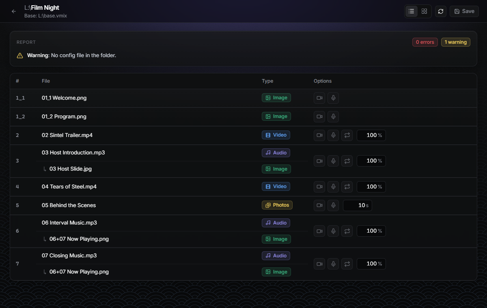
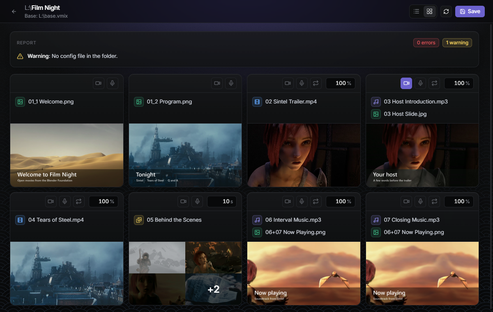
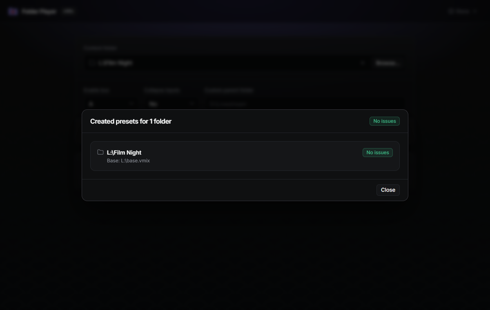

# Introduction

vMix Folder Player turns a folder of numbered media files into a vMix playlist. You put
the videos, audio, images, photo folders and PowerPoint decks for a session in one folder,
number them in the order they should play, and the app generates a vMix preset from them.

## From a folder to vMix

1. Create a folder and give every file a leading number to set its place in the playlist
   (see [Numbering files](../2-content-folder/1-numbering.md)). Put a `base.vmix` with your
   cameras, mics and outputs in the folder or its parent (see [Base vMix preset](2-base-preset.md)).

    

2. Open the folder in the app and click **Open Config**. The config page lists every
   playlist item with its type and options, with a report of any problems above the list.

    

3. Review the playlist. For each item you can turn the camera and microphone on or off (for
   example, to put the host on camera over a lower-third image), and set loop, volume or
   slideshow time (see [Item options](../2-content-folder/2-options.md)). Switch to the
   preview view to see each item's media at a glance.

    

4. Click **Save** (it's enabled once you change something), go back and click
   **Create vMix Preset**. The app writes a `<folder name>.vmix` preset into the content
   folder, built from your base preset, and shows a report of any errors or warnings.

    

5. Open that preset in vMix.

    

## Supported inputs

Images, video files, audio files, folders of photos (played as a slideshow) and PowerPoint
`.pptx` files.
